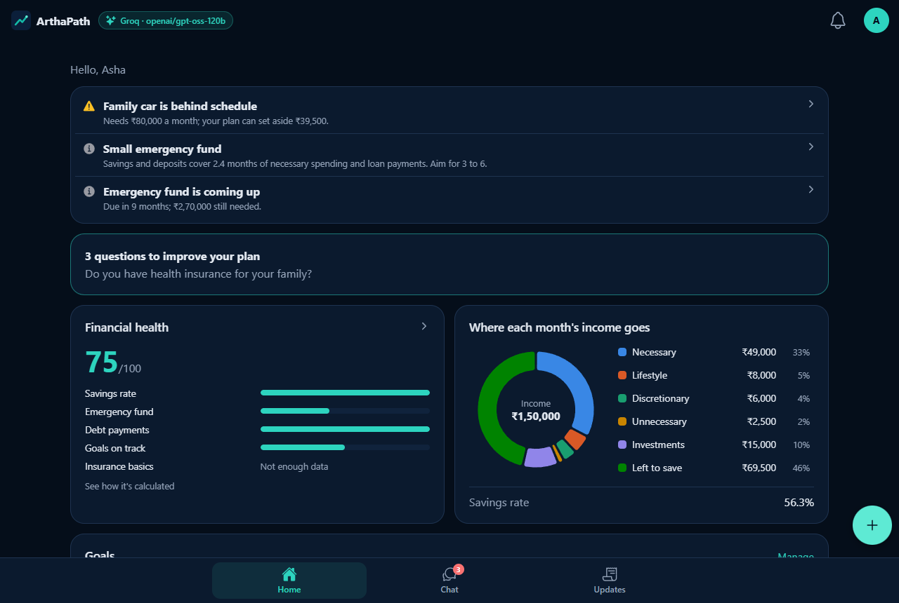
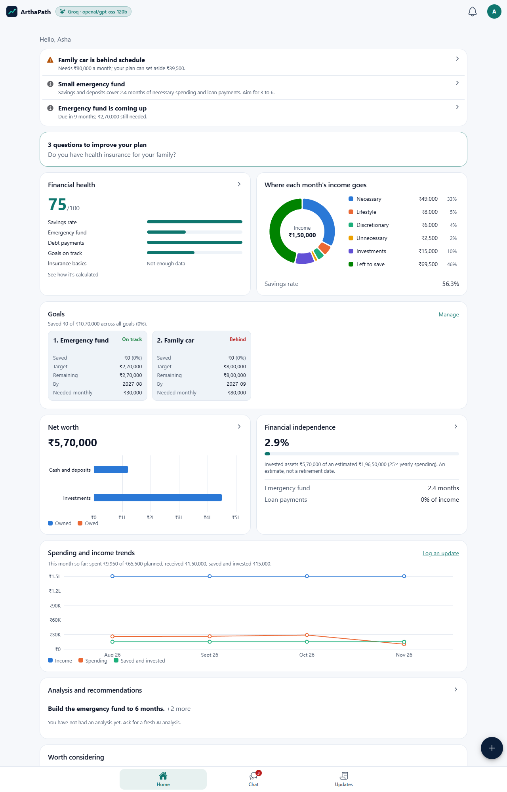
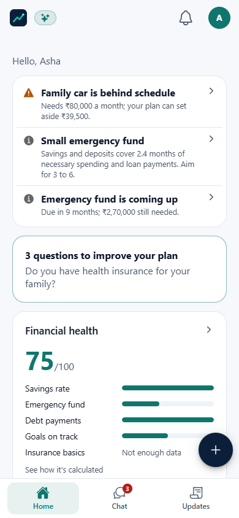
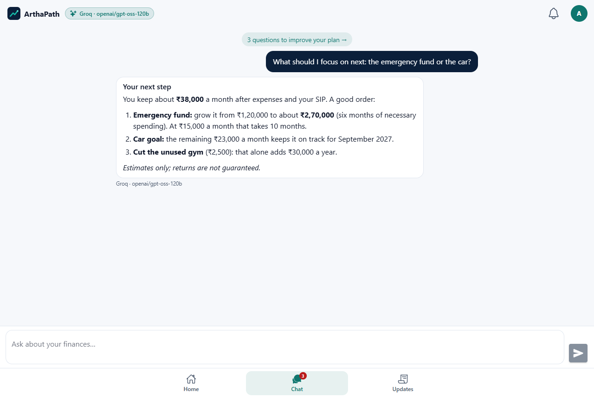
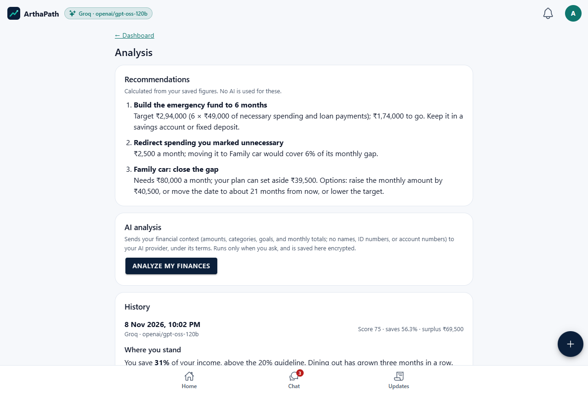
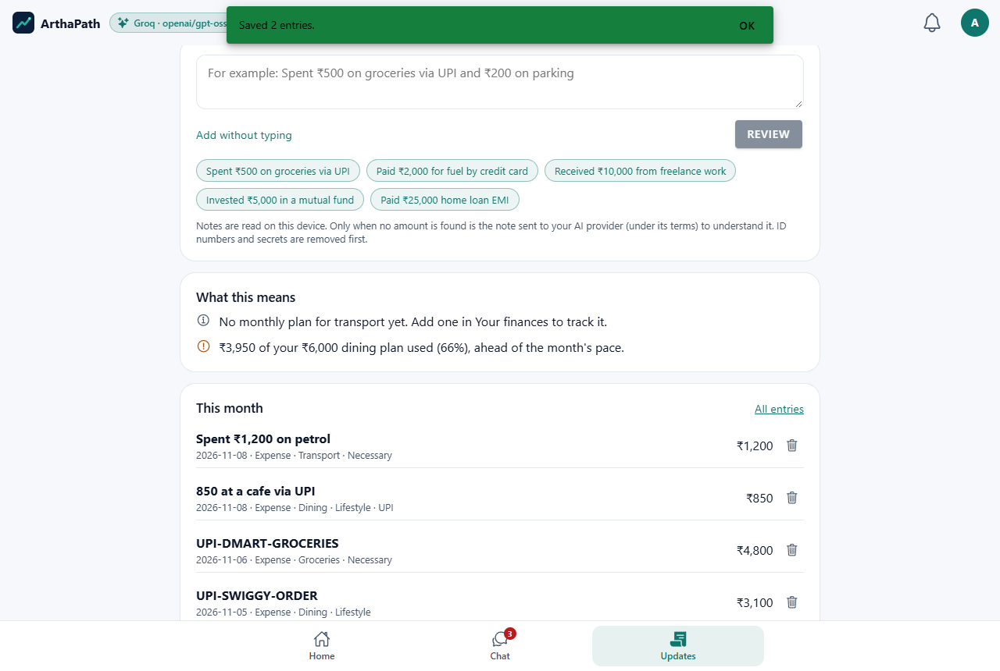
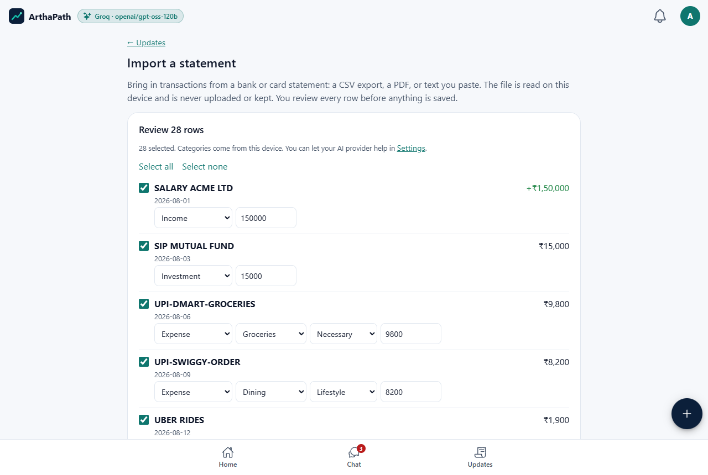
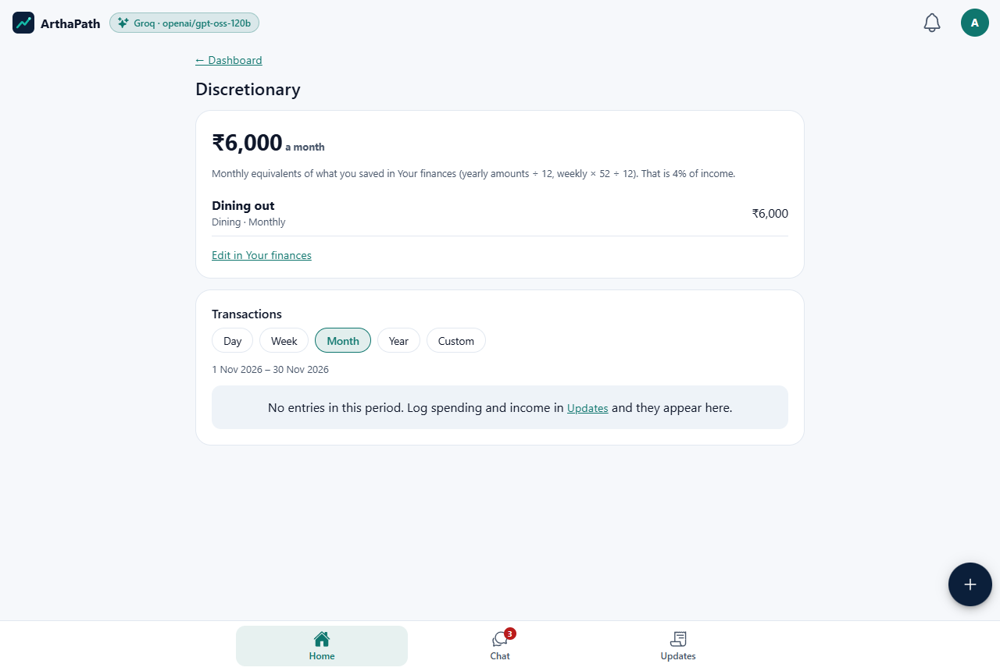
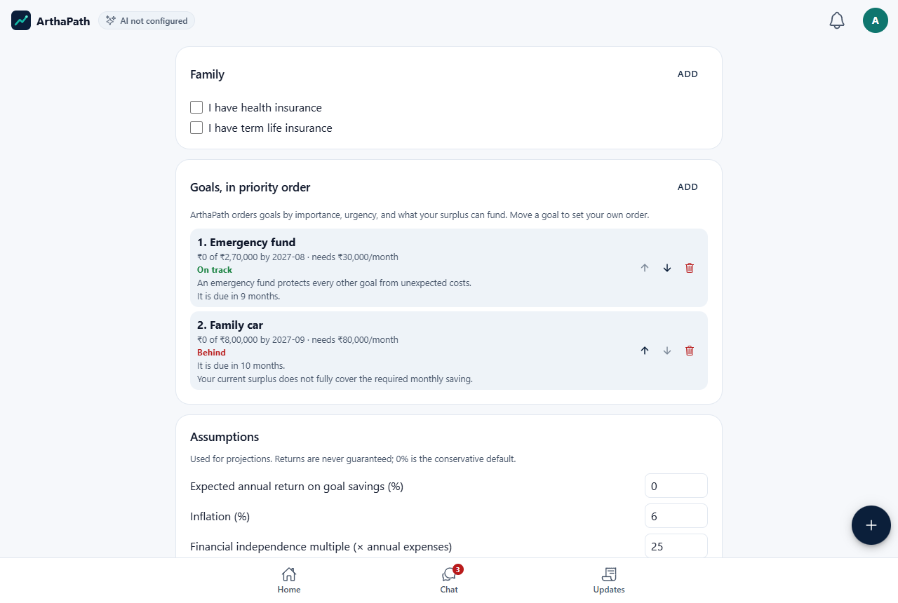
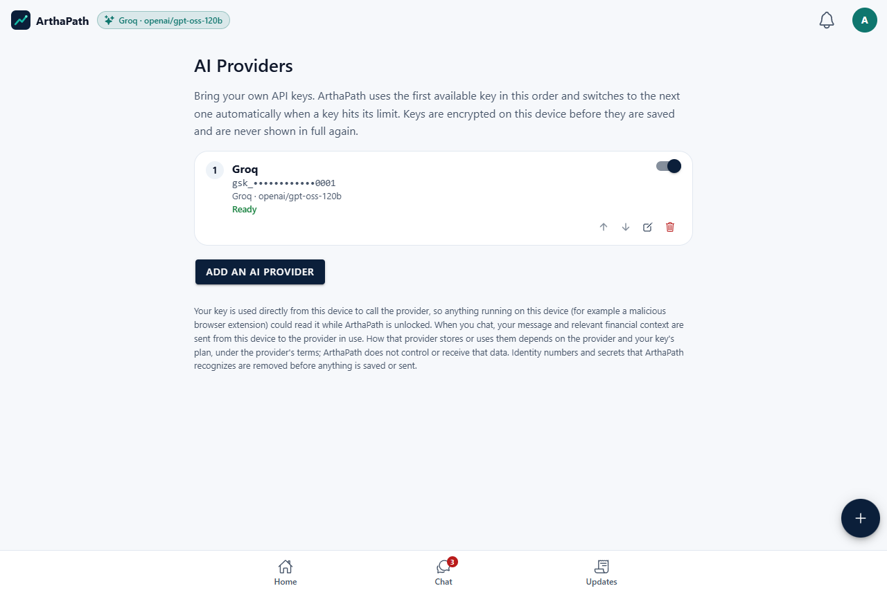

# ArthaPath

**Your Money. Your Goals. Your Financial Future.**

ArthaPath is an open-source, AI-assisted personal financial planning and goal
management app. Describe your finances in plain language, and ArthaPath builds
a private, encrypted financial profile, a live dashboard, and a prioritized
goal plan. You bring your own AI keys, from any supported provider.

> **Status:** version 1.0. Try it at <https://arthapath-prod.web.app>, or
> install the Android app from [Releases](https://github.com/deepakdaneva/arthapath/releases).
> Progress and plans: [docs/PROJECT_STATUS.md](docs/PROJECT_STATUS.md).



## Why ArthaPath

- **Private by design.** Financial data is encrypted on your device
  (AES-256-GCM, key derived from your PIN with Argon2id). The database only
  ever stores ciphertext. Lose the PIN and the data is unrecoverable; there
  is no backdoor.
- **Bring your own AI key.** Google Gemini, Groq, OpenRouter, or any
  OpenAI-compatible endpoint. Add many keys, set priority, and ArthaPath
  falls back automatically when one hits its limit, without losing
  conversation context.
- **Real math, not guesses.** Every figure comes from deterministic,
  tested TypeScript calculations. The AI explains, categorizes, and
  recommends; it never acts as the calculator.
- **Free to run.** Built entirely on the Firebase Spark (no-cost) plan.
  Anyone can deploy their own copy.

## Features

- **Dashboard:** financial health score, where each month's income goes
  (necessary, lifestyle, discretionary, unnecessary, investments), goals,
  net worth, financial independence, and monthly trends. Every figure
  drills down to the items and the calculation behind it.
- **Early warnings:** goals falling behind, a thin emergency fund, spending
  over plan, and a reminder when updates stop.
- **Updates:** log activity in plain language ("Spent ₹500 on groceries via
  UPI"), review it, and see what it means for your plan.
- **Statement import:** CSV, PDF, or pasted text, read on your device and
  never uploaded. Duplicates are flagged and every row is reviewed.
- **AI chat and analysis:** ask about your finances or request an analysis;
  the AI explains the app's calculated numbers. ID numbers and secrets are
  removed on the device before anything is sent.
- **Questions:** the app asks only for what it is missing.
- Light and dark themes; works on phone and desktop.

## Screenshots

| | |
|---|---|
|  |  |
| **Dashboard** with drill-down charts | **Phone** layout |
|  |  |
| **AI chat** with your own key | **Analysis** on request |
|  |  |
| **Updates** in plain language | **Statement import** on the device |
|  |  |
| **Details** behind every figure | **Your finances** by form or chat |
|  |  |
| **AI providers** with automatic fallback | **Landing page** |

Screenshots use a demo account with made-up numbers
(`npm run screenshots` regenerates them).

## Technology

| Layer | Choice |
|---|---|
| UI | Ionic 9, Angular 22 (standalone, signals), TypeScript |
| Native | Capacitor 8 (Android now, iOS later) |
| Charts | Apache ECharts (tree-shaken) |
| Backend | Firebase Auth, Cloud Firestore, Firebase Hosting (Spark plan) |
| Crypto | WebCrypto AES-256-GCM, Argon2id via `hash-wasm` |
| AI | Provider-agnostic adapter layer, BYOK |
| CI/CD | GitHub Actions, keyless Workload Identity Federation |

See [docs/architecture/ARCHITECTURE.md](docs/architecture/ARCHITECTURE.md)
and the [ADRs](docs/architecture/ADR/).

## Getting started

```bash
npm ci
npm run emulators   # terminal 1
npm start           # terminal 2, http://localhost:4200
```

- Prerequisites and local setup: [docs/development/LOCAL_SETUP.md](docs/development/LOCAL_SETUP.md)
- Firebase setup (your own projects): [docs/deployment/FIREBASE_SETUP.md](docs/deployment/FIREBASE_SETUP.md)
- Environment configuration: [docs/deployment/ENVIRONMENT_CONFIGURATION.md](docs/deployment/ENVIRONMENT_CONFIGURATION.md)
- AI provider setup: [docs/architecture/AI_PROVIDER_ARCHITECTURE.md](docs/architecture/AI_PROVIDER_ARCHITECTURE.md)
- Testing: [docs/development/TESTING_GUIDE.md](docs/development/TESTING_GUIDE.md)
- Deployment: [docs/deployment/GITHUB_ACTIONS.md](docs/deployment/GITHUB_ACTIONS.md)

## Branches and environments

| Branch | Environment |
|---|---|
| `main` | Production |
| `development` | UAT |
| `feature/*`, `bugfix/*` | Local / PR checks only |
| `hotfix/*` | Production fix, merged to `main` and back to `development` |

## Contributing

Contributions are welcome. Read [CONTRIBUTING.md](CONTRIBUTING.md) and the
[Code of Conduct](CODE_OF_CONDUCT.md). Report security issues privately per
[SECURITY.md](SECURITY.md).

## Disclaimer

ArthaPath provides informational financial assistance only. AI output can be
wrong, projections are estimates, and investment returns are never
guaranteed. It is not a substitute for a qualified financial, tax, or legal
professional.

## License

[Apache License 2.0](LICENSE). Keep the copyright notice and [NOTICE](NOTICE)
file when redistributing.
